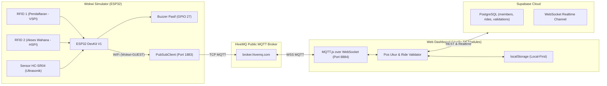

# COCOMANG SmartHeight — Wokwi Simulation & Cloud Sync

Pos sistem pengukuran tinggi badan otomatis dan validasi akses wahana rekreasi berbasis **ESP32 DevKit V1 + Dual RFID MFRC522 (VSPI & HSPI) + Sensor Ultrasonik HC-SR04 + Buzzer Pasif**, disimulasikan secara nirkabel melalui **Wokwi Simulator (WiFi + MQTT over WebSocket)**, terhubung ke dashboard web tanpa ketergantungan serial fisik, serta disinkronkan ke database cloud **Supabase (PostgreSQL & Realtime)**.

---

## 📋 Ikhtisar & Arsitektur Sistem

Branch ini mengimplementasikan integrasi simulasi nirkabel Wokwi untuk mempermudah demonstrasi dan pengujian perangkat lunak tanpa membutuhkan perangkat keras fisik di meja kerja:



### Keunggulan Utama:
- **Zero Web Serial Dependency**: Dashboard berkomunikasi secara nirkabel melalui **MQTT over WebSocket** (`wss://broker.hivemq.com:8884/mqtt`). Tidak membutuhkan kabel USB data, izin COM port peramban, ataupun browser khusus Chromium (dapat diakses dari Firefox, Safari, smartphone, maupun tablet).
- **Dual RFID Reader Hardware SPI**:
  - **RFID 1 (Pendaftaran Member)**: Membaca kartu RFID di loket pendaftaran, otomatis mengisi input UID form registrasi (mendukung 4-byte, 7-byte, dan 10-byte UID).
  - **RFID 2 (Gerbang Akses Wahana)**: Memvalidasi kelayakan pengunjung saat men-tap kartu di wahana permainan.
- **Validasi Akses Wahana (*Ride Validator*)**: Sistem mencocokkan tinggi badan pengunjung dengan katalog wahana (*Roller Coaster Halilintar*, *Kora-Kora*, *Bianglala*, *Arena Bumper Car Anak*) dan membunyikan buzzer ESP32 secara interaktif via pesan MQTT Command.
- **Arsitektur Local-First & Supabase**: Dashboard beroperasi 100% secara offline via `localStorage`, dan secara otomatis menyinkronkan data member dan log validasi ke Supabase PostgreSQL saat terhubung ke internet.

---

## 🔌 Rangkaian Pin ESP32 (Wokwi & Hardware)

| Komponen | Pin Modul | Pin ESP32 | Keterangan Sirkuit |
|---|---|---|---|
| **RFID Reader 1**<br>*(Pendaftaran)* | SCK | GPIO 18 | Bus VSPI Hardware |
| | MISO | GPIO 19 | Bus VSPI Hardware |
| | MOSI | GPIO 23 | Bus VSPI Hardware |
| | SDA / SS | GPIO 5 | Chip Select RFID 1 |
| | RST | GPIO 22 | Hardware Reset RFID 1 |
| | 3.3V & GND | 3V3 & GND | Sumber daya 3.3V & Ground |
| **RFID Reader 2**<br>*(Akses Wahana)* | SCK | GPIO 14 | Bus HSPI Hardware |
| | MISO | GPIO 32 | Bus HSPI (*remapped* dari GPIO 12 untuk mencegah gagal boot) |
| | MOSI | GPIO 13 | Bus HSPI Hardware |
| | SDA / SS | GPIO 4 | Chip Select RFID 2 |
| | RST | GPIO 21 | Hardware Reset RFID 2 |
| | 3.3V & GND | 3V3 & GND | Sumber daya 3.3V & Ground |
| **HC-SR04**<br>*(Ultrasonik)* | VCC | 5V / VIN | Sumber daya 5V |
| | TRIG | GPIO 25 | Output trigger pulsa 10 µs |
| | ECHO | GPIO 26 | Input echo melalui pembagi tegangan (R1=1kΩ seri, R2=2kΩ ke GND) |
| | GND | GND | Ground |
| **Buzzer Pasif** | SIGNAL / (+) | GPIO 27 | Output frekuensi PWM (2.000 Hz) |
| | GND / (-) | GND | Ground |

---

## 📡 Protokol Komunikasi MQTT

Sistem menggunakan broker publik HiveMQ dengan topik MQTT terstruktur:

| Arah | Topik MQTT | Format Payload | Deskripsi |
|---|---|---|---|
| **ESP32 -> Web** | `cocomang/smartheight/telemetry` | JSON | Telemetri jarak sensor dan estimasi tinggi badan setiap 500 ms |
| **ESP32 -> Web** | `cocomang/smartheight/rfid` | Plaintext | Event deteksi kartu pada Reader 1 atau Reader 2 |
| **Web -> ESP32** | `cocomang/smartheight/command` | Karakter ASCII | Perintah kendali buzzer dan pemicu diagnostik |

### Contoh Payload:
1. **Telemetri Pengukuran (`cocomang/smartheight/telemetry`)**:
   ```json
   {"type":"measurement","device":"smartheight-esp32","sequence":28,"status":"ok","distanceCm":52.4,"heightCm":167.6,"referenceHeightCm":220.0,"validSamples":1,"uptimeMs":14500}
   ```
2. **Event RFID Reader 1 (`cocomang/smartheight/rfid`)**:
   ```text
   [RFID 1 - PENDAFTARAN] Kartu Terdeteksi! UID: 04:A1:B2:C3:D4
   ```
3. **Event RFID Reader 2 (`cocomang/smartheight/rfid`)**:
   ```text
   [RFID 2 - AKSES WAHANA] Kartu Terdeteksi! UID: 04:A1:B2:C3:D4
   ```
4. **Perintah Command (`cocomang/smartheight/command`)**:
   - `'b'`: Membunyikan 1 bip pendek (200 ms) saat akses wahana disetujui.
   - `'n'`: Membunyikan 3 bip peringatan (100 ms on/off) saat akses wahana ditolak.
   - `'u'`: Memaksa sensor HC-SR04 membaca jarak dan mempublikasikan telemetri seketika.
   - `'r'`: Memeriksa status chip RFID pada serial monitor Wokwi.

---

## 🗄️ Konfigurasi Database Supabase Cloud

1. **Deploy Skema SQL**:
   Salin dan jalankan seluruh isi file [`supabase/schema.sql`](./supabase/schema.sql) pada **SQL Editor** Supabase.
   Skrip ini secara otomatis membuat:
   - Tabel `members`: UID kartu RFID, nama, usia, jenis kelamin, berat, dan tinggi badan.
   - Tabel `rides`: Katalog wahana permainan beserta batasan tinggi minimum & maksimum.
   - Tabel `ride_validations`: Log akses pengunjung ke gerbang wahana permainan.
   - Hak akses Row Level Security (RLS) anon publik & publikasi Realtime WebSocket.
2. **Konfigurasi Kredensial via `.env`**:
   Salin template ke `dist/.env`:
   ```powershell
   Copy-Item dist/.env.example dist/.env
   ```
   Buka file `dist/.env` lalu isi:
   ```env
   SUPABASE_URL=https://your-project-id.supabase.co
   SUPABASE_ANON_KEY=your-anon-public-key-here
   ```
*(Detail selengkapnya tersedia pada [`docs/PANDUAN-SUPABASE.md`](./docs/PANDUAN-SUPABASE.md)).*

---

## 🚀 Cara Menjalankan Sistem

### Langkah 1: Jalankan Simulasi Wokwi
1. Buka [https://wokwi.com/projects/new/esp32](https://wokwi.com/projects/new/esp32) (atau gunakan ekstensi Wokwi di VS Code).
2. Salin isi [`firmware/smartheight_wokwi/diagram.json`](./firmware/smartheight_wokwi/diagram.json) ke tab **diagram.json** Wokwi.
3. Salin kode [`firmware/smartheight_wokwi/smartheight_wokwi.ino`](./firmware/smartheight_wokwi/smartheight_wokwi.ino) ke tab sketch.
4. Pada tab **Library Manager** Wokwi, tambahkan library `PubSubClient`.
5. Klik **Play/Start Simulation**.

### Langkah 2: Jalankan Web Dashboard
Buka terminal di folder `cocomang`:
```powershell
py -m http.server 8000 --directory dist
```
Buka peramban pada URL:
```text
http://localhost:8000
```
Klik tombol **"Hubungkan Wokwi"** di bagian atas dashboard. Status koneksi akan langsung berubah menjadi **`🟢 Wokwi Terhubung`**.

### Langkah 3: Alur Uji Coba:
- **Pendaftaran Member**: Klik modul RFID 1 di simulator Wokwi lalu dekatkan kartu virtual. Modal pendaftaran member di dashboard akan otomatis terbuka dengan UID terisi. Masukkan nama dan simpan.
- **Pengukuran Tinggi**: Geser slider jarak pada modul sensor HC-SR04 di Wokwi. Nilai tinggi badan akan terupdate secara real-time di tab **Pengukuran Live**. Klik simpan untuk mencatat ke profil member.
- **Validasi Akses Wahana**: Buka tab **Member**, pilih wahana (misal: *Roller Coaster Halilintar* min 140 cm), lalu dekatkan kartu ke modul RFID 2 di Wokwi. Dashboard akan menampilkan hasil verifikasi kelayakan (Lolos/Ditolak) dan memicu buzzer ESP32.

---

## 🧪 Pengujian Otomatis (*Automated Unit Testing*)

Proyek ini dilengkapi dengan 29 automated unit test:

```powershell
npm test
```

Verifikasi sintaks modul ES:
```powershell
npm run check
```

Cakupan pengujian (29 tests passing):
- **Wokwi MQTT Transport**: Verifikasi konfigurasi broker, parser telemetri, dan event deteksi RFID (`tests/wokwi-transport.test.mjs` — 5 tests)
- **Model Data Member & Storage**: Format UID RFID, validasi nama/gender/berat, pencegahan duplikasi UID, dan penghapusan member (`tests/data.test.mjs` — 7 tests)
- **Ride Access Validator**: Logika batas kelayakan tinggi min/max wahana dan kalkulasi selisih (`tests/ride-validation.test.mjs` — 6 tests)
- **Serial Protocol Parser**: Validasi frame JSON telemetri dan log serial regular expression (`tests/serial-protocol.test.mjs` — 4 tests)
- **Supabase Mapper**: Pemetaan dua arah model camelCase <-> snake_case PostgreSQL (`tests/supabase-mapper.test.mjs` — 2 tests)

---

## 📚 Dokumen Terkait

- [`firmware/smartheight_wokwi/README.md`](./firmware/smartheight_wokwi/README.md) — Panduan cepat simulasi Wokwi nirkabel.
- [`docs/PANDUAN-SUPABASE.md`](./docs/PANDUAN-SUPABASE.md) — Panduan konfigurasi Supabase PostgreSQL & Realtime.
- [`docs/PANDUAN-PENGUJIAN-LIVE.md`](./docs/PANDUAN-PENGUJIAN-LIVE.md) — Prosedur operasional kalibrasi sensor fisik.
- [`DESIGN.md`](./DESIGN.md) & [`QA.md`](./QA.md) — Spesifikasi teknis & checklist jaminan kualitas.
