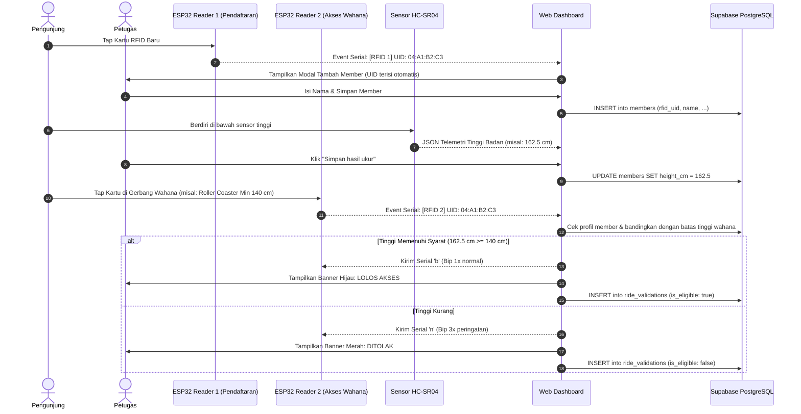

# Panduan Integrasi Database Supabase — COCOMANG SmartHeight

Panduan langkah demi langkah untuk mengaktifkan database cloud **Supabase** (PostgreSQL) pada proyek COCOMANG SmartHeight Progres 2.

---

## 1. Persiapan Proyek di Supabase

1. Buka [https://supabase.com](https://supabase.com) dan masuk menggunakan akun GitHub / email kamu.
2. Buat proyek baru (*New Project*):
   - **Name**: `cocomang-smartheight` (atau sesuai keinginan)
   - **Database Password**: Buat password yang aman
   - **Region**: Pilih `Singapore (ap-southeast-1)` untuk latensi tercepat dari Indonesia.
3. Tunggu 1–2 menit hingga penyediaan database selesai.

---

## 2. Menjalankan Skema Database (DDL SQL)

1. Pada sidebar dashboard Supabase, buka menu **SQL Editor**.
2. Klik **New query**.
3. Buka file [`cocomang/supabase/schema.sql`](../supabase/schema.sql), lalu salin seluruh kodenya.
4. Tempel (*paste*) kode tersebut ke SQL Editor Supabase, lalu klik tombol **Run**.
5. Script ini akan secara otomatis:
   - Membuat tabel `members` (kartu RFID, nama, usia, berat, tinggi badan terkini).
   - Membuat tabel `rides` (katalog wahana: Roller Coaster, Kora-kora, Bianglala, Bumper Car).
   - Membuat tabel `ride_validations` (log akses wahana & hasil pengukuran).
   - Mengatur Row Level Security (RLS) dengan hak akses publik (*anon*).
   - Mengaktifkan publikasi Supabase Realtime (WebSocket).

---

## 3. Mengambil Kredensial API Supabase

1. Pada sidebar Supabase, buka **Project Settings** (ikon gerigi) → **API**.
2. Salin 2 nilai berikut:
   - **Project URL**: contoh `https://xyzcompany.supabase.co`
   - **Project API Keys** → `anon` `public`: contoh `eyJhbGciOiJIUzI1NiIsInR5cCI6IkpXVCJ9...`

---

## 4. Menghubungkan ke Dashboard COCOMANG

1. Jalankan web dashboard secara lokal:
   ```powershell
   cd cocomang
   py -m http.server 8000 --directory dist
   ```
2. Buka browser Chromium (Edge / Chrome) di `http://localhost:8000`.
3. Pada header navigasi atas, klik tombol status Supabase: **`⚪ Setel Supabase`** (atau `🟡 Mode Lokal`).
4. Masukkan **Project URL** dan **Anon Public Key** yang sudah kamu salin.
5. Klik **Tes Koneksi** → Pastikan muncul tanda hijau: *Sukses: Terhubung ke database Supabase!*
6. Klik **Simpan Pengaturan**. Status di header akan berubah menjadi **`🟢 Cloud Terhubung`**.
7. Jika kamu sudah memiliki data member lokal di browser, klik **"Sinkronkan Data Lokal ke Cloud"** untuk mengunggahnya ke Supabase secara otomatis.

---

## 5. Alur Pengujian Sistem (Dual RFID & Sensor HC-SR04)



---

## 6. Sifat Local-First & Offline Resilient

- **Koneksi Internet Terputus**: Pos ukur tetap dapat berjalan 100% menggunakan memori `localStorage` browser lokal. Pengukuran dan pendaftaran member tidak akan terblokir.
- **Koneksi Kembali Aktif**: Cukup buka modal database dan klik tombol sinkronisasi untuk mencadangkan data ke Supabase.
- **Multi-Layar / Multi-Device**: Jika Supabase terhubung, penambahan member atau pengukuran dari perangkat lain akan otomatis muncul secara live (*real-time WebSocket*) tanpa perlu me-refresh browser.
